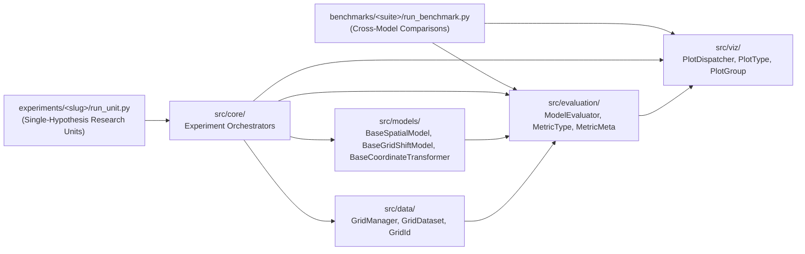

# ML TransDat Code Architecture & Engineering Blueprint

Reference architecture for `src/`, `experiments/`, and `benchmarks/` in `ml_transdat`. All new models, datasets, metrics, plots, and experiment units **must** adhere to these interfaces and package boundaries.

---

## 1. Package Topology & Layering

| Directory | Responsibility | What Belongs Here |
| :--- | :--- | :--- |
| `src/data/` | Data & Grid Access | `GridId`, `GridDataset`, `GridManager`, `get_default_grid_manager`, lazy samplers, on-the-fly grid generators |
| `src/geometry/` | Cell Geometry & Features | `CellPlane`, `CellPlane2D`, `extract_grid_cell_planes`, `ShapeCategory`, `CellShapeFeatureExtractor`, `compute_spg_cell_uv`, `encode_cyclic_cell_uv` |
| `src/models/` | Transformation & ML Models | `BaseSpatialModel`, `BaseGridShiftModel`, `BaseCoordinateTransformer`, `ResidualCoordinateTransformer`, `_torch_trainer` (`train_torch_regressor`), `load_embedded_spg_helmert_params`, concrete estimators (`KNNSpatialRegressor`, `DecisionTreeSpatialRegressor`, `AdaptiveQuadtreeRegressor`, `MLPGridShiftModel`, `TorchMLPGridShiftModel`, `NeuralFeatureGridShiftModel`, `CellBilinearShiftModel`, `ParameterizedBicubicGridShiftModel`, `CompositeResidualShiftModel`, `HistGBRGridShiftModel`, `PolynomialSurfaceRegressor`, `RBFSurfaceRegressor`, `Helmert2DConformalShiftModel`, `TwoStepHelmert2DTransformer`, `PyprojEpsg3844Transformer`) |
| `src/evaluation/` | Metrics & Benchmarking | `MetricType`, `MetricMeta`, `MetricGroup` (`SURFACE_LEARNABILITY`), `compute_spatial_roughness_stats`, `EvaluationResult`, `ModelEvaluator` (`evaluate_models`, `tabulate_results`, `tabulate_delta_vs_baseline`, `compare_models`, `rank_surface_candidates`), `NaN`-safe scorecards & Markdown formatters |
| `src/viz/` | Declarative Visualization | `PlotType`, `PlotGroup` (`SURFACE_DIAGNOSTIC`), `PlotDispatcher` (`render_grouped` 1-row-per-model figures), matplotlib plotting functions (`plot_spatial_error_rows`, `plot_hist_ecdf_rows`, `plot_signed_scatter_rows`, `plot_subcell_heatmap_rows`, `plot_vector_quiver_rows`, `plot_residual_roughness_rows`, `plot_extreme_scenarios_9cells`, `plot_surface_learnability_ranking`, `plot_multi_dataset_comparison`, `plot_model_comparison`, `plot_memory_breakdown_stacked`, `plot_speed_workloads`, `plot_surface_comparison_grids`) |
| `src/core/` | Experiment & Benchmark Lifecycle | `ResearchUnit`, `ExperimentType`, `TransformationExperimentUnit`, `TransformationModelSpec`, `GridShiftExperimentUnit`, `AnalysisExperimentUnit`, `ExperimentModelSpec`, `BenchmarkSuite`, `BenchmarkModelSpec`, `specs_from_unit` |
| `experiments/<slug>/` | Micro Research Units | Thin declarative `run_unit.py`, `report.md`, `unit_brief.json` (v2), `results/`, `plots/` (unified 1-row-per-model PNGs), gitignored `models/` (`.pkl` checkpoints) |
| `benchmarks/<suite>/` | Macro Cross-Model Suites | `BenchmarkSuite` subclass `run_benchmark.py`, `summary_scorecard.md`, comparative `plots/`, `results/` |
| `data/features/` | Shared Feature Tables | Canonical feature datasets (`cell_planes.parquet`, `cell_shape_metrics.parquet`) exported by `analysis` units |

---

## 2. Data & Grid Layer (`src/data/`)

- **Registry (`GridId` enum)**: All canonical grids and benchmarks are referenced via [`GridId`](../src/data/catalog.py) (`SPG_NODES_VALID`, `RO_GRID_4X4`, `RO_GRID_8X8`, `RO_GRID_16X16`, `RO_TRAIN_ADAPTIVE_HYBRID`, `RO_TRAIN_BORDER_ENRICHED_4X4`, `ADAPTIVE_*`, `CORRIDOR_SNW`, `SINGLE_CELL_10K`, `RO_TEST_UNIFORM_4X4`, `RO_TEST_UNIFORM_8X8`, `RO_TEST_UNIFORM_16X16`, `RO_TEST_ADAPTIVE_3MM_MID`, `RO_TEST_ADAPTIVE_1MM_MID`, `CUSTOM`) — never hardcode Parquet paths in models or experiments.
- **Unified Loader (`GridManager` / `get_default_grid_manager()`)**:
  - `GridManager().get(grid_id, force_regenerate=False)` resolves in order: in-memory cache → static Parquet (if present) → local disk cache (gitignored `.cache/grids/`) → dynamic on-the-fly generator.
  - **On-the-fly vs. Static Policy**:
    - `SPG_NODES_VALID`, `RO_GRID_4X4`, `RO_GRID_8X8`, `RO_GRID_16X16`, and `SINGLE_CELL_10K` generate dynamically via [`src/data/samplers.py`](../src/data/samplers.py) (populating `shift_dn_m`/`shift_de_m` in one pass).
    - `ADAPTIVE_*` and `CORRIDOR_SNW` load from static Parquet files under `data/`.
- **Dataset Access Modes**:
  - Full arrays: `dataset.coords` (`(N, 2)` `[st70_n, st70_e]`), `dataset.true_shifts` (`(N, 2)` `[dn, de]`), `dataset.etrs89_rad` (`(N, 2)`).
  - Generator streaming: `GridManager.iter_chunks(grid_id, batch_size)` streams uncached densified grids cell-by-cell lazily via `iter_densified_grid_chunks` without materializing full DataFrames.
  - Cell-aligned regional subgrids: `CellRegion(row_start, col_start, n_rows, n_cols)` + `GridDataset.slice_region(region)` / `GridManager.get_region(grid_id, region)` extract exact `.spg`-aligned rectangular windows (with `.padded(pad_cells)` for training halos and `find_worst_case_region(size_cells)` for proxy benchmarking).

---

## 3. Model Hierarchy (`src/models/`)

### 3.1 `BaseSpatialModel`
Defined in [`src/models/base.py`](../src/models/base.py) as the shared root for both shift regressors and full transformers, providing:
- `memory_footprint_bytes()` and 4-component `memory_breakdown()` (`MemoryBreakdown`: `code_bytes`, `dependencies_bytes`, `model_instance_bytes`, `grid_lookup_bytes`) via `_runtime_dependencies()` and `_grid_lookup_bytes()` hooks.

### 3.2 `BaseGridShiftModel` (2D Residual Regressors)
Uses the **Template Method** pattern:
- Subclasses implement only:
  - `_fit_impl(self, coords: np.ndarray, shifts: np.ndarray) -> None`
  - `_predict_impl(self, coords: np.ndarray) -> np.ndarray`
  - Optional `_runtime_dependencies()` and `_grid_lookup_bytes()`
- The base class provides `fit(coords, shifts)`, `fit_stream(chunks)`, `predict(coords)`, `compute_sync_fingerprint(train_grid)`, `save_checkpoint(path, train_grid)`, `load_or_fit(..., cache_path=...)`, `assess(dataset_or_coords, true_shifts)` (using `GridId.CUSTOM` for raw arrays), `report(eval_result)`, and `plot(eval_result, out_dir, plots=...)`.
- **Fingerprint-Synced Model Persistence**: By default (`ExperimentModelSpec.persist_model = True`), fitted models are persisted to gitignored `experiments/<slug>/models/<spec_name>.pkl` with a SHA-256 fingerprint covering source code (`inspect.getsourcefile`, recursive for composite models), constructor hyperparameters, and `train_grid`. Both `GridShiftExperimentUnit` and `BenchmarkSuite` (via `specs_from_unit`) reuse valid `.pkl` checkpoints or automatically retrain and update them whenever model code or hyperparameters change.
- [`AdaptiveQuadtreeRegressor`](../src/models/quadtree_regressor.py) uses a depth-bucketed lattice `np.searchsorted` index for $O(D \log N)$ vectorized lookup.

### 3.3 `BaseCoordinateTransformer` & `ResidualCoordinateTransformer`
- [`BaseCoordinateTransformer`](../src/models/base.py) defines bidirectional `etrs89_to_st70(lat_rad, lon_rad)` and `st70_to_etrs89(n, e)` alongside `assess()`, `report()`, `plot()`, and `memory_breakdown()`.
- [`ResidualCoordinateTransformer`](../src/models/base.py) composes any analytical base (`TwoStepHelmert2DTransformer`) with any fitted `BaseGridShiftModel` using exact `TransRO` sign conventions (`-` in `st70_to_etrs89`, `+` in `etrs89_to_st70`).

---

## 4. Evaluation & Metrics Layer (`src/evaluation/`)

- **Constants (`MetricType`, `MetricMeta`, `MetricGroup`)**: Defined in [`src/evaluation/metrics.py`](../src/evaluation/metrics.py).
  - Every `MetricType` carries structured [`MetricMeta`](../src/evaluation/metrics.py) (`label`, `dimension`, `is_integer`) and `format_metric_label(metric, precision_unit="mm")` handles unit conversion (`mm` default).
  - `_summarize_slice` is `NaN`-safe and reports `count` (matched), `total_count`, `unmatched_count`, and `coverage_pct`.
  - **Stage-2 ML Surface Learnability (`MetricGroup.SURFACE_LEARNABILITY`)**: Automatically computed via `compute_spatial_roughness_stats` (`scipy.spatial.cKDTree`, `k=4` neighbors) on every evaluation: `CRMSE_2D_M` ($\sqrt{\text{Var}(e_N)+\text{Var}(e_E)}$), `IQR_2D_M`, `ROUGHNESS_GRAD_RMS_MM_KM`, `ROUGHNESS_GRAD_P95_MM_KM`, `LOCAL_JITTER_RATIO`, and composite `LEARNABILITY_SCORE_MM`.
- **Evaluator (`ModelEvaluator`)**:
  - `evaluate_models(models, dataset)` executes a single inference pass per model; `tabulate_results(results, metrics, precision_unit="mm")` projects any metric subset with zero re-inference; `rank_surface_candidates(results)` ranks Stage-1 base surfaces by `Learnability Score (mm)`.
  - `EvaluationResult.to_scorecard_row(precision_unit="mm")` defaults to millimeters (`mm`).

---

## 5. Declarative Visualization Layer (`src/viz/`)

- **Constants (`PlotType` & `PlotGroup`)**: Defined in [`src/viz/registry.py`](../src/viz/registry.py). Includes `PlotGroup.SURFACE_DIAGNOSTIC` (`SPATIAL_ERROR`, `HIST_ECDF`, `RESIDUAL_ROUGHNESS`).
- **Dispatcher (`PlotDispatcher`)**: `PlotDispatcher.render_grouped(...)` groups evaluation results by `(dataset_id, direction, plot_type)` into **one unified PNG per `PlotType`** (`{dataset_id}_{direction}_{plot_type}.png`) where **each model occupies its own row** (`plot_spatial_error_rows`, `plot_hist_ecdf_rows`, `plot_signed_scatter_rows`, `plot_subcell_heatmap_rows`, `plot_vector_quiver_rows`, `plot_residual_roughness_rows`).
- **9-Cell Extreme Scenario Transects & Learnability Ranking**: `plot_extreme_scenarios_9cells(...)` renders the canonical 99 km (9-cell: 4 left + target + 4 right) Group 1 (`Gradient & Linear`) and Group 2 (`Curvature & Kinks`) comparisons against `TransDatRO`. `plot_surface_learnability_ranking(...)` renders the `cRMSE` vs. `Roughness RMS` Pareto frontier and Top-K decomposed cost chart.
- **Cross-Model & Cross-Dataset Plots**: `plot_model_comparison(..., precision_unit="mm")`, `plot_multi_dataset_comparison(...)` (zero-re-inference grouped bars), `plot_speed_workloads(...)`, and 2-panel `plot_memory_breakdown_stacked(...)` in [`src/viz/plots.py`](../src/viz/plots.py).

---

## 6. Experiment & Benchmark Orchestration (`src/core/`)

- [`GridShiftExperimentUnit`](../src/core/base_unit.py) automates the 2D grid-shift research unit lifecycle (`ExperimentType.GRID_SHIFT`):
  - Supports both trained models (`train_grid=GridId.SPG_NODES_VALID`) and pre-built lookup models (`train_grid=None`).
  - Subclasses implement `get_model_specs() -> list[ExperimentModelSpec]` and optional `get_extreme_scenario_models(fitted_models)` / `after_run(fitted_models, results)`. When `render_extreme_scenarios=True` (default) and models are kept in memory, `run()` automatically generates `extreme_scenarios_gradient_and_linear_9cells.png` and `extreme_scenarios_curvature_and_kinks_9cells.png`.
  - Automatically emits Schema v2 `unit_brief.json` with `key_metrics` (including surface learnability metrics) and `benchmark_candidates`.
- [`AnalysisExperimentUnit`](../src/core/base_unit.py) automates exploratory, geometric, and feature-engineering units (`ExperimentType.ANALYSIS`), exporting shared tables to `data/features/`.
- [`BenchmarkSuite`](../src/core/base_benchmark.py) automates 3-view cross-model suites (`summary_scorecard.md`, `plots/`, `results/benchmark_summary.json`), pulling validated models directly via `specs_from_unit(...)`.

---

## 7. Extension Checklist

- **Adding a new Grid Shift Model**: Subclass `BaseGridShiftModel` in `src/models/<name>.py`, implement `_fit_impl`, `_predict_impl`, and `_runtime_dependencies()` / `_grid_lookup_bytes()`; export in `src/models/__init__.py`.
- **Adding a new Experiment**: Create `experiments/<slug>/run_unit.py` inheriting `GridShiftExperimentUnit`, `TransformationExperimentUnit`, or `AnalysisExperimentUnit`. Never duplicate models, metrics, sampling, or plotting helpers inside `experiments/`. Run `experiment-sync` to validate and document.
- **Adding or Updating a Benchmark**: Subclass `BenchmarkSuite` under `benchmarks/<suite>/run_benchmark.py` and pull promoted variants via `specs_from_unit(...)` (or run `benchmark-sync`).
