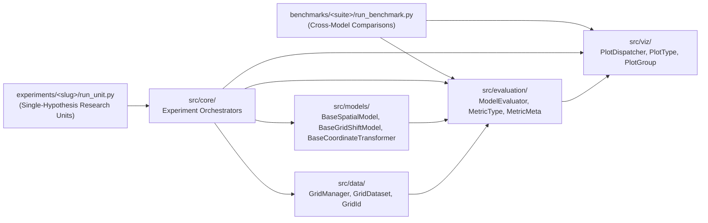

# ML TransDat Code Architecture & Engineering Blueprint

Reference architecture for `src/`, `experiments/`, and `benchmarks/` in `ml_transdat`. All new models, datasets, metrics, plots, and experiment units **must** adhere to these interfaces and package boundaries.

---

## 1. Package Topology & Layering

| Directory | Responsibility | What Belongs Here |
| :--- | :--- | :--- |
| `src/data/` | Data & Grid Access | `GridId`, `GridDataset`, `GridManager`, `get_default_grid_manager`, lazy samplers, on-the-fly grid generators |
| `src/models/` | Transformation & ML Models | `BaseSpatialModel`, `BaseGridShiftModel`, `BaseCoordinateTransformer`, `ResidualCoordinateTransformer`, concrete estimators (`KNNSpatialRegressor`, `DecisionTreeSpatialRegressor`, `AdaptiveQuadtreeRegressor`, `TwoStepHelmert2DTransformer`, `PyprojEpsg3844Transformer`) |
| `src/evaluation/` | Metrics & Benchmarking | `MetricType`, `MetricMeta`, `MetricGroup`, `EvaluationResult`, `ModelEvaluator` (`evaluate_models`, `tabulate_results`, `compare_models`), `NaN`-safe scorecards & Markdown formatters |
| `src/viz/` | Declarative Visualization | `PlotType`, `PlotGroup`, `PlotDispatcher`, matplotlib plotting functions (`plot_model_comparison`, `plot_memory_breakdown_stacked`, `plot_speed_workloads`) |
| `src/core/` | Experiment Lifecycle | `ResearchUnit`, `TransformationExperimentUnit`, `GridShiftExperimentUnit`, `ExperimentModelSpec` |
| `experiments/<slug>/` | Micro Research Units | Thin declarative `run_unit.py`, `report.md`, `README_AI.md`, `unit_brief.json`, `results/`, `plots/` |
| `benchmarks/<suite>/` | Macro Cross-Model Suites | `run_benchmark.py`, `summary_scorecard.md`, comparative `plots/`, `results/` |

---

## 2. Data & Grid Layer (`src/data/`)

- **Registry (`GridId` enum)**: All canonical grids and benchmarks are referenced via [`GridId`](../src/data/catalog.py) (`SPG_NODES_VALID`, `RO_GRID_4X4`, `RO_GRID_8X8`, `RO_GRID_16X16`, `ADAPTIVE_*`, `CORRIDOR_SNW`, `SINGLE_CELL_10K`, `CUSTOM`) — never hardcode Parquet paths in models or experiments.
- **Unified Loader (`GridManager` / `get_default_grid_manager()`)**:
  - `GridManager().get(grid_id, force_regenerate=False)` resolves in order: in-memory cache → static Parquet (if present) → local disk cache (gitignored `.cache/grids/`) → dynamic on-the-fly generator.
  - **On-the-fly vs. Static Policy**:
    - `SPG_NODES_VALID`, `RO_GRID_4X4`, `RO_GRID_8X8`, `RO_GRID_16X16`, and `SINGLE_CELL_10K` generate dynamically via [`src/data/samplers.py`](../src/data/samplers.py) (populating `shift_dn_m`/`shift_de_m` in one pass).
    - `ADAPTIVE_*` and `CORRIDOR_SNW` load from static Parquet files under `data/`.
- **Dataset Access Modes**:
  - Full arrays: `dataset.coords` (`(N, 2)` `[st70_n, st70_e]`), `dataset.true_shifts` (`(N, 2)` `[dn, de]`), `dataset.etrs89_rad` (`(N, 2)`).
  - Generator streaming: `GridManager.iter_chunks(grid_id, batch_size)` streams uncached densified grids cell-by-cell lazily via `iter_densified_grid_chunks` without materializing full DataFrames.

---

## 3. Model Hierarchy (`src/models/`)

### 3.1 `BaseSpatialModel`
Defined in [`src/models/base.py`](../src/models/base.py) as the shared root for both shift regressors and full transformers, providing:
- `memory_footprint_bytes()` and 4-component `memory_breakdown()` (`MemoryBreakdown`: `code_bytes`, `dependencies_bytes`, `model_instance_bytes`, `grid_lookup_bytes`) via `_runtime_dependencies()` and `_grid_lookup_bytes()` hooks.

### 3.2 `BaseGridShiftModel` (2D Residual Regressors)
Uses the **Template Method** pattern:
- Subclasses implement only:
  - `_fit_impl(self, coords: np.ndarray, shifts: np.ndarray) -> None`
  - `_predict_impl(self, coords: np.ndarray) -> np.ndarray`
  - Optional `_runtime_dependencies()` and `_grid_lookup_bytes()`
- The base class provides `fit(coords, shifts)`, `fit_stream(chunks)`, `predict(coords)`, `assess(dataset_or_coords, true_shifts)` (using `GridId.CUSTOM` for raw arrays), `report(eval_result)`, and `plot(eval_result, out_dir, plots=...)`.
- [`AdaptiveQuadtreeRegressor`](../src/models/quadtree_regressor.py) uses a depth-bucketed lattice `np.searchsorted` index for $O(D \log N)$ vectorized lookup.

### 3.3 `BaseCoordinateTransformer` & `ResidualCoordinateTransformer`
- [`BaseCoordinateTransformer`](../src/models/base.py) defines bidirectional `etrs89_to_st70(lat_rad, lon_rad)` and `st70_to_etrs89(n, e)` alongside `assess()`, `report()`, `plot()`, and `memory_breakdown()`.
- [`ResidualCoordinateTransformer`](../src/models/base.py) composes any analytical base (`TwoStepHelmert2DTransformer`) with any fitted `BaseGridShiftModel` using exact `TransRO` sign conventions (`-` in `st70_to_etrs89`, `+` in `etrs89_to_st70`).

---

## 4. Evaluation & Metrics Layer (`src/evaluation/`)

- **Constants (`MetricType`, `MetricMeta`, `MetricGroup`)**: Defined in [`src/evaluation/metrics.py`](../src/evaluation/metrics.py).
  - Every `MetricType` carries structured [`MetricMeta`](../src/evaluation/metrics.py) (`label`, `dimension`, `is_integer`) and `format_metric_label(metric, precision_unit="mm")` handles unit conversion (`mm` default).
  - `_summarize_slice` is `NaN`-safe and reports `count` (matched), `total_count`, `unmatched_count`, and `coverage_pct`.
- **Evaluator (`ModelEvaluator`)**:
  - `evaluate_models(models, dataset)` executes a single inference pass per model; `tabulate_results(results, metrics, precision_unit="mm")` projects any metric subset with zero re-inference.
  - `EvaluationResult.to_scorecard_row(precision_unit="mm")` defaults to millimeters (`mm`).

---

## 5. Declarative Visualization Layer (`src/viz/`)

- **Constants (`PlotType` & `PlotGroup`)**: Defined in [`src/viz/registry.py`](../src/viz/registry.py).
- **Dispatcher (`PlotDispatcher`)**: Uses a handler registry and raises explicit `ValueError` for unsupported `PlotType`s or missing context (`transect_models`).
- **Cross-Model Plots**: `plot_model_comparison(..., precision_unit="mm")`, `plot_speed_workloads(...)`, and 2-panel `plot_memory_breakdown_stacked(...)` (Model+Lookup vs. Full Deployment incl. Dependencies) in [`src/viz/plots.py`](../src/viz/plots.py).

---

## 6. Experiment Orchestration (`src/core/`)

- [`GridShiftExperimentUnit`](../src/core/base_unit.py) automates the research unit lifecycle:
  - Supports both trained models (`train_grid=GridId.SPG_NODES_VALID`) and pre-built lookup models (`train_grid=None`).
  - Subclasses implement `get_model_specs() -> list[ExperimentModelSpec]` and optional `after_run(fitted_models, results)`.

---

## 7. Extension Checklist

- **Adding a new Grid Shift Model**: Subclass `BaseGridShiftModel` in `src/models/<name>.py`, implement `_fit_impl`, `_predict_impl`, and `_runtime_dependencies()` / `_grid_lookup_bytes()`; export in `src/models/__init__.py`.
- **Adding a new Experiment**: Create `experiments/<slug>/run_unit.py` inheriting `GridShiftExperimentUnit` (or `TransformationExperimentUnit`). Never duplicate models, metrics, sampling, or plotting helpers inside `experiments/`.
- **Adding a new Benchmark**: Add a suite under `benchmarks/<suite>/run_benchmark.py` using `ModelEvaluator.evaluate_models` + `tabulate_results(..., precision_unit="mm")`.
