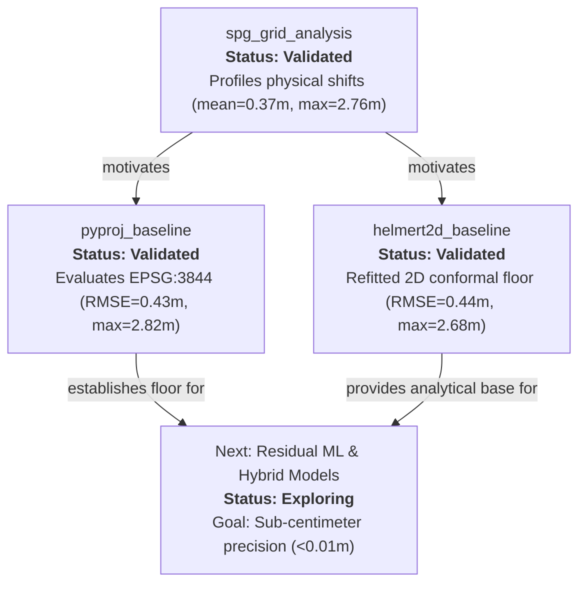

# Research Roadmap & Knowledge Graph

Master map of research units, annotated relationships, and current scientific state for **ETRS89 ↔ Stereo 70** coordinate transformation modeling.

> **Current State TL;DR**: All three foundational baselines (`spg_grid_analysis`, `pyproj_baseline`, `helmert2d_baseline`) are **Validated**. They establish a $\sim 0.44\,\text{m}$ RMSE / $2.68\,\text{m}$ max-error floor for global linear/conformal models and confirm that sub-centimeter ($< 0.01\,\text{m}$) accuracy requires learning the non-linear 2D bicubic `.spg` distortion field via residual ML models.

---

## 1. Research Topology DAG

---

## 2. Annotated Relationships

| From | To | Relation | Meaning / Rationale |
| :--- | :--- | :--- | :--- |
| `spg_grid_analysis` | `pyproj_baseline` | `motivates` | Profiling `.spg` shifts showed localized $2.76\,\text{m}$ distortions; we needed to verify whether standard GIS (`EPSG:3844`) already models them (it does not). |
| `spg_grid_analysis` | `helmert2d_baseline` | `motivates` | Knowing the `.spg` field is smooth and dominated by 2D shifts motivated fitting an optimal grid-free 4-parameter 2D conformal floor. |
| `pyproj_baseline` | `Residual ML Models` | `establishes floor` | Sets the external GIS industry benchmark ($\text{RMSE}=0.435\,\text{m}$, $\text{Max}=2.82\,\text{m}$) that any ML model must decisively beat. |
| `helmert2d_baseline` | `Residual ML Models` | `provides base` | Proves `StereoProj + Helmert2D` is analytically invertible ($5.24 \times 10^{-9}\,\text{m}$ round-trip) and leaves clean, zero-bias 2D residuals for ML learning. |

---

## 3. Research Units Index

| Slug | Status | Strategic Summary | Primary Sources |
| :--- | :---: | :--- | :--- |
| [`spg_grid_analysis`](spg_grid_analysis.md) | `Validated` | Physical profiling of `.spg` 2D shifts ($\text{Mean}=0.372\,\text{m}$, $\text{Max}=2.757\,\text{m}$); identifies localized peaks in Banat/West, Maramureș, and Dobrogea. | [`experiments/spg_grid_analysis/`](../../experiments/spg_grid_analysis/README_AI.md) |
| [`pyproj_baseline`](pyproj_baseline.md) | `Validated` | Standard `EPSG:3844` vs. ground truth ($\text{RMSE}=0.4348\,\text{m}$, $\text{Max}=2.82\,\text{m}$); proves standard GIS lacks local distortion modeling. | [`experiments/pyproj_baseline/`](../../experiments/pyproj_baseline/README_AI.md) |
| [`helmert2d_baseline`](helmert2d_baseline.md) | `Validated` | Refitted 4-param 2D conformal Helmert on 2,222 valid nodes ($\text{RMSE}=0.4429\,\text{m}$, $\text{Max}=2.6811\,\text{m}$); optimal linear/conformal floor. | [`experiments/helmert2d_baseline/`](../../experiments/helmert2d_baseline/README_AI.md) |
