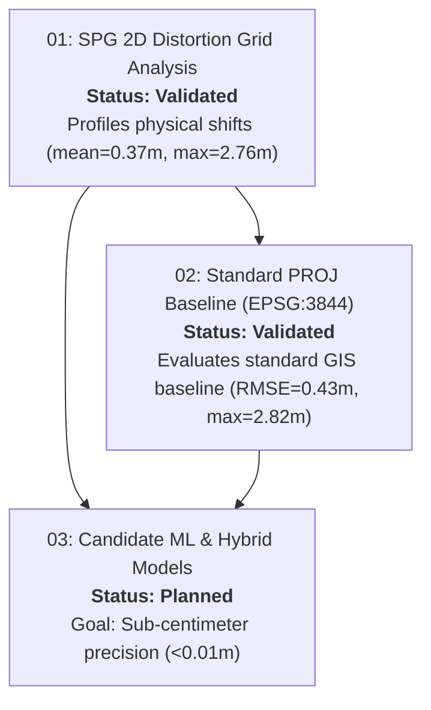

# Research Roadmap

Master map of research branches, hypotheses, rationales, and discoveries for coordinate transformation between **ETRS89** and **Stereo 70**.

---

## 1. Research Topology DAG

---

## 2. Research Branches Index

| Branch | Directory / File | Status | Description | Key Findings |
|:---|:---|:---:|:---|:---|
| **01** | [`01_spg_grid_analysis.md`](01_spg_grid_analysis.md) | `Validated` | Physical spatial profiling of official CNC 2D bicubic distortion field ($dN, dE$) and vector orientations across Romania. | $\text{Mean}=0.372\,\text{m}$, $\text{Max}=2.757\,\text{m}$. Significant localized southwestward displacement in Banat/West and north in Maramureș. |
| **02** | [`02_pyproj_baseline.md`](02_pyproj_baseline.md) | `Validated` | Evaluation of modern GIS library standard (`pyproj` with `EPSG:3844` Pulkovo 1942(58) / Stereo70) against ground truth. | $\text{Mean 2D}=0.3601\,\text{m}$, $\text{RMSE}=0.4348\,\text{m}$, $\text{Max}=2.82\,\text{m}$. Proves standard GIS error matches distortion grid magnitude. |

---

## 3. Active Hypotheses & Next Steps
- **Branch 03 (Upcoming)**: Can lightweight coordinate-conditioned regressors (MLP, RBF, or Fourier Feature networks) learn the bicubic distortion grid directly, achieving $< 0.01\,\text{m}$ (1 cm) RMSE nationwide?
