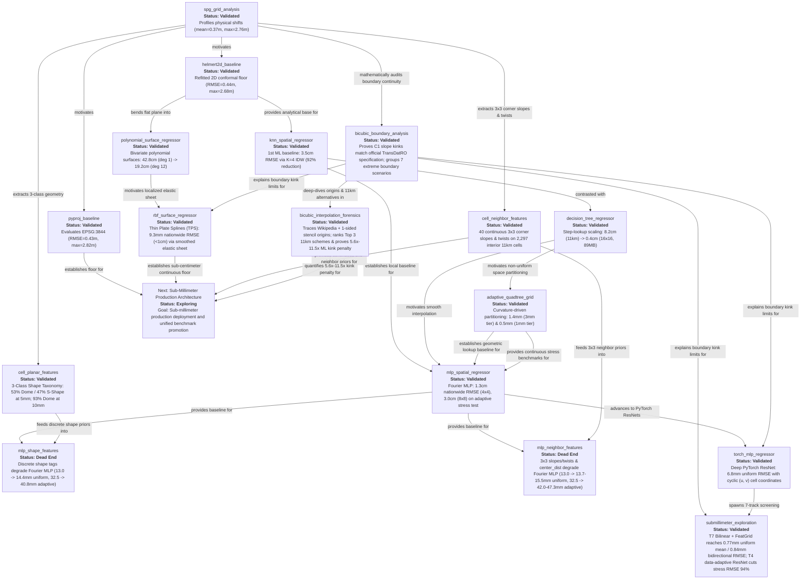

# Research Roadmap & Knowledge Graph

Master map of research units, annotated relationships, and current scientific state for **ETRS89 ↔ Stereo 70** coordinate transformation modeling.

> **Current State TL;DR**: All three foundational baselines (`spg_grid_analysis`, `pyproj_baseline`, `helmert2d_baseline`) are **Validated**. They establish a $\sim 0.44\,\text{m}$ RMSE / $2.68\,\text{m}$ max-error floor for global linear/conformal models and confirm that sub-centimeter ($< 0.01\,\text{m}$) accuracy requires learning the non-linear 2D bicubic `.spg` distortion field via residual ML models.

---

## 1. Research Topology DAG

---

## 2. Annotated Relationships

| From | To | Relation | Meaning / Rationale |
| :--- | :--- | :--- | :--- |
| `spg_grid_analysis` | `pyproj_baseline` | `motivates` | Profiling `.spg` shifts showed localized $2.76\,\text{m}$ distortions; we needed to verify whether standard GIS (`EPSG:3844`) already models them (it does not). |
| `spg_grid_analysis` | `helmert2d_baseline` | `motivates` | Knowing the `.spg` field is smooth and dominated by 2D shifts motivated fitting an optimal grid-free 4-parameter 2D conformal floor. |
| `pyproj_baseline` | `Residual ML Models` | `establishes floor` | Sets the external GIS industry benchmark ($\text{RMSE}=0.435\,\text{m}$, $\text{Max}=2.82\,\text{m}$) that any ML model must decisively beat. |
| `helmert2d_baseline` | `polynomial_surface_regressor` | `bends flat plane into` | Upgrading the rigid flat Helmert plane to 2D polynomial surfaces introduces curvature, cutting error by half ($44.3\,\text{cm} \to 19.2\,\text{cm}$). |
| `helmert2d_baseline` | `Residual ML Models` | `provides base` | Proves `StereoProj + Helmert2D` is analytically invertible ($5.24 \times 10^{-9}\,\text{m}$ round-trip) and leaves clean, zero-bias 2D residuals for ML learning. |
| `helmert2d_baseline` | `knn_spatial_regressor` | `provides base` | Residuals from `StereoProj + Helmert2D` define the target 2D distortion field for spatial learning. |
| `polynomial_surface_regressor` | `rbf_surface_regressor` | `motivates localized elastic sheet` | Overcoming polynomial boundary oscillations (Runge's ceiling at $19.2\,\text{cm}$) motivated localized Thin Plate Splines ($9.3\,\text{mm}$ RMSE). |
| `rbf_surface_regressor` | `Sub-Millimeter Hybrids` | `establishes continuous floor` | Delivers first sub-centimeter nationwide continuous analytical surface ($9.3\,\text{mm}$) with zero lookup grid. |
| `knn_spatial_regressor` | `Continuous ML Models` | `establishes local baseline` | Sets the first spatial ML baseline ($0.0353\,\text{m}$ RMSE) and reveals official grid $C^0/C^1$ boundary slope kinks. |
| `knn_spatial_regressor` | `decision_tree_regressor` | `contrasted with` | Contrasts smooth local distance-weighted blending ($3.5\,\text{cm}$) against orthogonal axis-aligned step plateaus ($8.2\,\text{cm}$ on base nodes). |
| `decision_tree_regressor` | `adaptive_quadtree_grid` | `motivates non-uniform partitioning` | Proves that uniform step-lookup models waste memory on flat zones; adaptive quadtree splits only where curvature exceeds tolerance. |
| `adaptive_quadtree_grid` | `mlp_spatial_regressor` | `establishes geometric baseline` | Delivers $1.4\,\text{mm}$ (3mm tier) and $0.5\,\text{mm}$ (1mm tier) pure geometric lookup, establishing the compression baseline for neural models. |
| `adaptive_quadtree_grid` | `mlp_spatial_regressor` | `provides continuous stress benchmarks` | Quadtree cell midpoints provide the hard curvature-weighted stress test benchmark (`RO_TEST_ADAPTIVE_3MM_MID`). |
| `decision_tree_regressor` | `mlp_spatial_regressor` | `motivates smooth interpolation` | Proves step-lookup models require massive densification ($586\text{k}$ pts / $89\,\text{MB}$) to reach $4\,\text{mm}$, motivating smooth interpolators. |
| `mlp_spatial_regressor` | `cell_planar_features` | `identifies global capacity limit` | Proves single global neural net reaches $\sim 3\,\text{cm}$ floor on adaptive zones, motivating local patch re-parameterization and shape classification. |
| `cell_planar_features` | `Sub-Millimeter Hybrids` | `provides functional shape priors` | Decouples macro shift from micro curvature, classifying 100% of cells into Linear, Dome, or S-Shape for model conditioning. |
| `mlp_spatial_regressor` | `mlp_shape_features` | `provides baseline for` | Supplies the `mlp_fourier_4x4` baseline for testing whether discrete per-axis cell shape categories improve neural accuracy. |
| `mlp_spatial_regressor` | `mlp_neighbor_features` | `provides baseline for` | Supplies the `mlp_fourier_4x4` baseline for testing whether continuous $3\times 3$ neighbor slopes, twists, and midpoint distance improve neural accuracy. |
| `cell_neighbor_features` | `mlp_neighbor_features` | `feeds 3x3 neighbor priors into` | Supplies the 40 continuous corner slopes/twists and `[0, 1]` midpoint distance for controlled Fourier MLP ablation (`Dead End` via additive concatenation). |
| `spg_grid_analysis` | `bicubic_boundary_analysis` | `mathematically audits boundary continuity` | Audits whether 1D transect slope breaks at 11 km cell boundaries are code bugs or intrinsic to the official TransDatRO standard (they match the published specification verbatim). |
| `bicubic_boundary_analysis` | `Continuous ML Models` | `explains boundary kink limits` | Proves that because official ground truth contains $C^1$ creases at every 11 km border, global continuous models naturally smooth over them; capturing sub-millimeter detail requires localized feature grids or cell priors. |
| `bicubic_boundary_analysis` | `bicubic_interpolation_forensics` | `deep-dives origins & 11km alternatives in` | Audits all 4 ANCPI papers, traces Wikipedia + 1-sided edge-stencil origins, and benchmarks 6 alternative 11 km schemes (`Catmull-Rom`, `PCHIP`, `Natural Spline C²`). |
| `bicubic_interpolation_forensics` | `ML Production Architecture` | `quantifies 5.6x-11.5x kink penalty` | Proves `TransDatRO`'s $C^1$ kinks impose a `7.674 mm` vs `0.667–1.364 mm` smooth-ML error penalty, mandating cell-aware / `(u, v)` architectures for sub-mm replication. |
| `mlp_spatial_regressor` | `torch_mlp_regressor` | `advances to PyTorch ResNets` | Replaces single feedforward MLP with deep PyTorch ResNets and cyclic local cell coordinates, cutting uniform RMSE from 13.0 mm to 6.8 mm. |
| `torch_mlp_regressor` | `submillimeter_exploration` | `spawns 7-track screening` | Prompts structured multi-track exploration to break the sub-millimeter continuous ceiling. |

---

## 3. Research Units Index

| Slug | Status | Strategic Summary | Primary Sources |
| :--- | :---: | :--- | :--- |
| [`spg_grid_analysis`](spg_grid_analysis.md) | `Validated` | Physical profiling of `.spg` 2D shifts ($\text{Mean}=0.372\,\text{m}$, $\text{Max}=2.757\,\text{m}$); identifies localized peaks in Banat/West, Maramureș, and Dobrogea. | [`experiments/spg_grid_analysis/`](../../experiments/spg_grid_analysis/README_AI.md) |
| [`pyproj_baseline`](pyproj_baseline.md) | `Validated` | Standard `EPSG:3844` vs. ground truth ($\text{RMSE}=0.4348\,\text{m}$, $\text{Max}=2.82\,\text{m}$); proves standard GIS lacks local distortion modeling. | [`experiments/pyproj_baseline/`](../../experiments/pyproj_baseline/README_AI.md) |
| [`helmert2d_baseline`](helmert2d_baseline.md) | `Validated` | Refitted 4-param 2D conformal Helmert on 2,222 valid nodes ($\text{RMSE}=0.4429\,\text{m}$, $\text{Max}=2.6811\,\text{m}$); optimal linear/conformal floor. | [`experiments/helmert2d_baseline/`](../../experiments/helmert2d_baseline/README_AI.md) |
| [`polynomial_surface_regressor`](polynomial_surface_regressor.md) | `Validated` | Continuous 2D bivariate polynomial surface regressor; introduces curvature beyond the flat Helmert plane, cutting RMSE from $42.8\,\text{cm}$ ($D=1$, 3 terms) to $19.2\,\text{cm}$ ($D=12$, 91 terms) and reducing max error to $0.89\,\text{m}$. | [`experiments/polynomial_surface_regressor/`](../../experiments/polynomial_surface_regressor/README_AI.md) |
| [`rbf_surface_regressor`](rbf_surface_regressor.md) | `Validated` | Localized 2D Thin Plate Spline surface regressor; models distortion field as an elastic sheet, cutting error to **$9.3\,\text{mm}$ nationwide RMSE** ($< 1\,\text{cm}$) and $19.1\,\text{mm}$ on adaptive stress tests ($0\,\text{MB}$ grid lookup). | [`experiments/rbf_surface_regressor/`](../../experiments/rbf_surface_regressor/report.md) | [`src/models/rbf_surface.py`](../../src/models/rbf_surface.py) |
| [`knn_spatial_regressor`](knn_spatial_regressor.md) | `Validated` | First non-linear ML baseline ($K=4$ IDW achieves $\text{RMSE}=0.0353\,\text{m}$, $92.1\%$ reduction over floor); discovers piecewise $C^0/C^1$ grid kinks. | [`experiments/knn_spatial_regressor/`](../../experiments/knn_spatial_regressor/README_AI.md) |
| [`decision_tree_regressor`](decision_tree_regressor.md) | `Validated` | Orthogonal step-plateau scaling ($8.17\,\text{cm}$ on 11 km nodes $\to$ $0.40\,\text{cm}$ on `16x16` at $89.4\,\text{MB}$); impurity pruning compresses $87\%$ ($2.8\,\text{MB}$ at $1.88\,\text{cm}$). | [`experiments/decision_tree_regressor/`](../../experiments/decision_tree_regressor/report.md) | [`experiments/knn_spatial_regressor/`](../../experiments/knn_spatial_regressor/README_AI.md) |
| [`adaptive_quadtree_grid`](adaptive_quadtree_grid.md) | `Validated` | Curvature-driven quadtree space partitioning; achieves $1.4\,\text{mm}$ (3mm tier, 176k cells) and $0.5\,\text{mm}$ (1mm tier, 564k cells) with $>97\%$ fewer points than uniform grids. | [`experiments/adaptive_quadtree_grid/`](../../experiments/adaptive_quadtree_grid/README.md) | [`data/grids/adaptive/`](../../data/grids/adaptive/) |
| [`mlp_spatial_regressor`](mlp_spatial_regressor.md) | `Validated` | Continuous parametric neural network solving spectral bias via Random Fourier Features; achieves $1.3\,\text{cm}$ nationwide RMSE ($4\times 4$) and $3.0\,\text{cm}$ on adaptive stress test ($8\times 8$) with 0 lookup table. | [`experiments/mlp_spatial_regressor/`](../../experiments/mlp_spatial_regressor/report.md) | [`src/models/mlp.py`](../../src/models/mlp.py) |
| [`cell_planar_features`](cell_planar_features.md) | `Validated` | Functional geometric classification of $11\times 11\,\text{km}$ cells into a 3-class curvature taxonomy (Linear, Dome/Bowl, S-Shape); proves $92.5\%$ of Romania is quadratic at $10\,\text{mm}$ and $53\%/47\%$ Dome/S-Shape at $5\,\text{mm}$; delivers $O(1)$ spatial feature extractor. | [`experiments/cell_planar_features/`](../../experiments/cell_planar_features/report.md) | [`src/geometry/shape_classifier.py`](../../src/geometry/shape_classifier.py) |
| [`mlp_shape_features`](mlp_shape_features.md) | `Dead End` | Controlled ablation of discrete 3/5/10 mm per-axis shape categories and S-Shape sample weighting (`2x`, `3x`) on `mlp_fourier_4x4`; degrades RMSE (`13.0 -> 14.4 mm` uniform, `32.5 -> 40.8 mm` adaptive). | [`experiments/mlp_shape_features/report.md`](../../experiments/mlp_shape_features/report.md) |
| [`cell_neighbor_features`](cell_neighbor_features.md) | `Validated` | Extracts 40 continuous $3\times 3$ one-sided corner slopes and diagonal twists across 2,297 interior `11 km` cells; delivers $O(1)$ `CellNeighborFeatureExtractor`. | [`experiments/cell_neighbor_features/`](../../experiments/cell_neighbor_features/report.md) | [`src/geometry/neighbor_features.py`](../../src/geometry/neighbor_features.py) |
| [`mlp_neighbor_features`](mlp_neighbor_features.md) | `Dead End` | Controlled ablation of 32 slopes, 40 slopes+twists, and continuous `[0, 1]` midpoint distance on `mlp_fourier_4x4`; degrades RMSE (`13.0 -> 13.7–15.5 mm` uniform, `32.5 -> 42.0–47.3 mm` adaptive). | [`experiments/mlp_neighbor_features/report.md`](../../experiments/mlp_neighbor_features/report.md) |
| [`torch_mlp_regressor`](torch_mlp_regressor.md) | `Validated` | Deep PyTorch residual neural network with cyclic `(u, v)` local cell coordinates; achieves `6.8 mm` uniform RMSE and `95.6% < 1 cm`. | [`experiments/torch_mlp_regressor/report.md`](../../experiments/torch_mlp_regressor/report.md) |
| [`submillimeter_exploration`](submillimeter_exploration.md) | `Validated` | Multi-track sub-millimeter exploration; `T7_bilinear_plus_featgrid_8x8` achieves `0.77 mm` uniform mean / `0.84 mm` bidirectional RMSE; `T4` data-adaptive ResNet collapses adaptive stress RMSE by 94% to `2.59 mm`. | [`experiments/submillimeter_exploration/report.md`](../../experiments/submillimeter_exploration/report.md) |
| [`bicubic_boundary_analysis`](bicubic_boundary_analysis.md) | `Validated` | Proves `pytransdat` `Grid.BiInterp` matches published `TransDatRO` one-sided 3-point finite-difference formulas verbatim; $C^1$ slope kinks at 11 km borders are inherent to the specification. Establishes a 7-scenario taxonomy across 5-cell extended windows with true vertical-axis scaling. | [`experiments/bicubic_boundary_analysis/report.md`](../../experiments/bicubic_boundary_analysis/report.md) | [`pytransdat/trans_grid.py`](../../pytransdat/trans_grid.py) |
| [`bicubic_interpolation_forensics`](bicubic_interpolation_forensics.md) | `Validated` | Full forensic audit of 4 ANCPI PDFs (`2.22e-15 m` parity), Wikipedia + 1-sided edge-stencil origin, Top-3 $11\,\text{km}$ alternatives (`Catmull-Rom C¹`, `PCHIP C¹`, `Natural Spline C²`), and `5.6x–11.5x` smooth-ML learnability penalty proof. | [`experiments/bicubic_interpolation_forensics/report.md`](../../experiments/bicubic_interpolation_forensics/report.md) | [`src/models/grid_bicubic_variants.py`](../../src/models/grid_bicubic_variants.py) |
