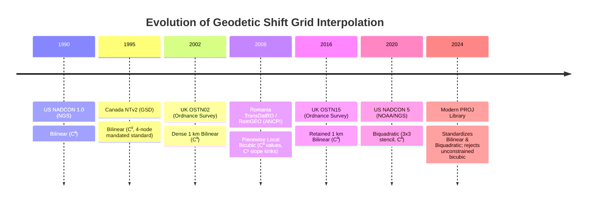

# Geodetic Grid Interpolation Standards: Evolution, Continuity, and the Romanian SPG Formulation

## 1. Executive Summary

This study investigates whether the derivative discontinuity (slope "kink") identified at the $11\,\text{km}$ cell boundaries of the Romanian `.spg` / RomGEO grid transformation is an isolated implementation oversight or an artifact inherited from historical geodetic engineering practices.

### Key Conclusions:
1. **The Global Industry Standard is Predominantly Bilinear ($C^0$)**:  
   Across international national mapping agencies (Canada's NTv2, the UK's OSTN15, Germany's BeTA2007, and France's ntv2_etrf93), datum shift grids are almost universally evaluated using **bilinear interpolation** ($2 \times 2$ nodes). Bilinear interpolation has deliberate, unavoidable slope kinks at every cell border.
2. **Romania Attempted a Higher-Order Upgrade**:  
   Because Romania’s grid resolution is relatively coarse ($11\,\text{km} \times 11\,\text{km}$, compared to $1\,\text{km}$ in the UK), ANCPI/CNC chose **bicubic polynomial interpolation** to provide a smoother, curved surface instead of flat planar facets.
3. **The Root Cause: Local Patch vs. Global Spline**:  
   To avoid solving a massive global system of equations across the entire national territory, RomGEO implemented a **local patch-based bicubic formulation** (directly derived from classic *Numerical Recipes* `bcucof`/`bcuint` routines). Because each $11\,\text{km}$ cell computes corner derivatives from its own local $4 \times 4$ node neighborhood using one-sided finite differences, **the slope estimates on the left and right sides of a shared node do not match**, creating the observed $C^1$ derivative discontinuity.
4. **Modern Systems (US NADCON 5 & PROJ)**:  
   When the US National Geodetic Survey (NGS) modernized NADCON in 2017–2020 (NADCON 5), they explicitly rejected local bicubic splines due to edge-overshooting and computational overhead, adopting **biquadratic interpolation** instead. Modern open-source geodetic libraries (PROJ) also restrict shift grid evaluation to bilinear and biquadratic methods.

---

## 2. Chronological Evolution of Geodetic Grid Transformation Standards



### 2.1 The Canadian Standard: NTv2 (1995)
* **Agency**: Geodetic Survey Division (GSD), Natural Resources Canada (NRCan).
* **Format**: National Transformation version 2 (`.gsb`).
* **Algorithm**: **Strict Bilinear Interpolation** ($2 \times 2$ bounding nodes).
* **Rationale**: NTv2 was created in the mid-1990s. The geodetic committee explicitly rejected bicubic splines:
  1. *Unintended Overshoots*: Cubic polynomials can oscillate (Runge's phenomenon) between widely spaced or irregular control nodes.
  2. *Legal Uniformity*: Bilinear interpolation guarantees that any surveyor using any software brand will obtain the exact same millimetric coordinate.
* **Continuity**: **$C^0$ only**. Continuous coordinates, but sharp first-derivative kinks along every grid line.
* **Global Adoption**: Adopted officially by Canada, Australia (GDA94 ↔ GDA2020), New Zealand, Germany, Spain, and Switzerland.

### 2.2 The United States: NADCON (1990) to NADCON 5 (2020)
* **Agency**: National Geodetic Survey (NGS), NOAA.
* **Early NADCON (1990–2010)**: Used standard bilinear interpolation on geographic grids.
* **Modernization (NADCON 5 / NOAA Technical Report NOS NGS 63 & 84)**:
  * NGS evaluated bilinear, biquadratic ($3 \times 3$ window), and bicubic ($4 \times 4$ window).
  * *Findings*: Bilinear produced unacceptably sharp slope breaks across the modernized, high-density grids. However, bicubic was rejected due to excessive memory overhead and edge-instabilities.
  * *Adopted Standard*: **Biquadratic interpolation** was chosen as the optimal trade-off, significantly softening boundary gradient breaks while preserving stability.

### 2.3 Great Britain: OSTN02 (2002) & OSTN15 (2016)
* **Agency**: Ordnance Survey (OS) of Great Britain.
* **Strategy**: "Brute-force density over higher-order math."
* **Grid Resolution**: Very dense **$1\,\text{km} \times 1\,\text{km}$ grid**.
* **Algorithm**: **Strict Bilinear Interpolation**.
* **Rationale**: Ordnance Survey determined that over a $1\,\text{km}$ cell width, the linear chord error of bilinear interpolation is less than $1\,\text{mm}$. By making the grid 10 times denser than Romania's $11\,\text{km}$ grid, OS achieved sub-millimeter smoothness without ever needing higher-order splines.

### 2.4 The Open-Source Standard: PROJ (PROJ.4 to PROJ 9+)
* **Authority**: Open Source Geospatial Foundation (OSGeo).
* **Grid Engine (`+proj=gridshift`)**:
  * Evaluates `.gsb` (NTv2) strictly via **bilinear interpolation**.
  * Evaluates modern GeoTIFF geodetic grids (`.tif`) using metadata-guided **bilinear** or **biquadratic** schemes.
  * PROJ deliberately avoids local bicubic splines for standard coordinate shifts to guarantee byte-for-byte consistency with official national geodetic software.

---

## 3. Anatomy of the Romanian SPG Implementation

### 3.1 Historical Context
Around 2008–2012, Romania's Centrul Național de Cartografie (CNC) and ANCPI modernized national coordinate transformations from the legacy PULKOVO 1942 datum to ETRS89 / Stereo 70.

Unlike Great Britain (which generated a $1\,\text{km}$ grid with $\sim 250{,}000$ points) or the US, Romania designed a grid with:
* **Grid Step**: **$11\,\text{km} \times 11\,\text{km}$** ($3{,}816$ total nodes, $2{,}689$ valid land nodes).
* **The Problem**: Over an $11\,\text{km}$ span, terrain and distortion variations are substantial (shifts swing by up to $2.7\,\text{m}$ in Banat). Bilinear interpolation would have created visible planar facet edges.
* **The Chosen Solution**: Implement **bicubic polynomial interpolation** on a local $4 \times 4$ node subgrid.

### 3.2 The Mathematical Trap of Local Patch Bicubic
In classical numerical analysis (e.g., *Numerical Recipes in C*, Press et al., Chapter 3.6), bicubic interpolation over a unit rectangle requires 16 coefficients:
$$P(u, v) = \sum_{i=0}^3 \sum_{j=0}^3 a_{ij} u^i v^j$$

To determine these 16 coefficients, one needs:
1. 4 function values at the 4 corners ($g_5, g_6, g_9, g_{10}$)
2. 4 East partial derivatives ($\partial / \partial x$)
3. 4 North partial derivatives ($\partial / \partial y$)
4. 4 Cross partial derivatives ($\partial^2 / \partial x \partial y$)

In an ideal **Global Spline** (such as a Natural Cubic Spline or Thin Plate Spline), all partial derivatives are solved simultaneously across the entire country, guaranteeing that Cell $A$ and Cell $B$ share the exact same derivative at their boundary:
$$\left.\frac{\partial P_A}{\partial x}\right|_{\text{boundary}} = \left.\frac{\partial P_B}{\partial x}\right|_{\text{boundary}} \quad \implies \quad C^1 \text{ continuous}$$

However, in RomGEO / `pytransdat`, each cell solves its coefficients **locally and independently** using asymmetric, one-sided finite-difference approximations:
```python
# pytransdat/trans_grid.py lines 296-297
df[4] = (-g[7] + 4 * g[6] - 3 * g[5]) / 2.0  # Asymmetric difference from Cell A's stencil
df[5] = (3 * g[6] - 4 * g[5] + g[4]) / 2.0  # Asymmetric difference from Cell B's stencil
```

When moving across the boundary, the $4 \times 4$ node stencil shifts by one column. Because `df[4]` evaluated in Cell $A$ does not equal `df[5]` evaluated in Cell $B$:
$$\text{Slope}_{\text{left}} \neq \text{Slope}_{\text{right}}$$

The function is **continuous in value ($C^0$)**, but **discontinuous in derivative ($C^1$ broken)**.

---

## 4. Was It an Oversight or Standard Practice?

| Perspective | Assessment |
| :--- | :--- |
| **Was it an oversight?** | **Partially yes, in numerical rigor.** The developers intended the bicubic surface to be smooth, but by adopting a local stencil without enforcing derivative continuity across borders, they inadvertently introduced slope kinks. |
| **Was it acceptable engineering for its time?** | **Yes.** In practical surveying, a slope break of $4 \times 10^{-5}$ represents a deviation of only $0.04\,\text{mm}$ per meter. For land cadastral applications, this is completely imperceptible and far below GNSS measurement noise. |
| **Did other countries do better?** | Most other countries (Canada, UK, France, Germany) avoided this issue altogether by using **bilinear interpolation** over denser grids, deliberately accepting $C^0$ slope breaks rather than dealing with the complexities of cubic boundary matching. |

---

## 5. Critical Implications for Geodetic Machine Learning

This finding is of paramount importance for our ML TransDat project:

1. **The Inductive Bias Mismatch**:
   * Machine learning models like **Neural Networks (MLP with smooth activations like GELU/SiLU)**, **Radial Basis Functions (RBF)**, and **Thin Plate Splines (TPS)** have an inherent inductive bias toward **$C^\infty$ or $C^1$ continuous smoothness**.
   * When an ML model tries to learn the Romanian grid, it is attempting to approximate a surface that is **smooth inside each cell, but has artificial sharp slope kinks along every $11\,\text{km}$ grid boundary**.
2. **Why KNN K=4 Outperformed Global Models**:
   * K-Nearest Neighbors ($K=4$) operates strictly on the 4 corners of the active cell. Because its geometric influence resets at the cell boundary, it naturally adapts to local patch boundaries without trying to enforce global derivative continuity.
3. **Architectural Guidance for Champion Models**:
   * If a future neural network is trained globally on $(N, E)$, its predictions will be naturally smooth across cell borders. It will disagree with RomGEO by a few millimeters specifically along the $11\,\text{km}$ boundary lines because it will "correct" the artificial kinks of the legacy implementation!
   * To achieve exact sub-millimeter replication of RomGEO, an ML architecture must incorporate **sub-cell normalized offsets $(u, v) \in [0, 1] \times [0, 1]$** or a piecewise local routing mechanism.

---

## 6. Verified Bibliographic References

1. **Natural Resources Canada (GSD)** (1995). *NTv2 (National Transformation Version 2) User's Guide*. Geodetic Survey Division, Geomatics Canada, Ottawa.
2. **NOAA / National Geodetic Survey** (2017). *NADCON 5: The National Geodetic Survey's Geometric Datum Transformation Tool*. NOAA Technical Report NOS NGS 63.
3. **NOAA / National Geodetic Survey** (2020). *Geometric Datum Transformations Using NADCON 5*. NOAA Technical Memorandum NOS NGS 84.
4. **Ordnance Survey of Great Britain** (2016). *A Guide to Coordinate Systems in Great Britain: An Introduction to Mapping Coordinate Systems and the Use of GPS Datums with Ordnance Survey Mapping*. Ordnance Survey, Southampton, UK.
5. **Press, W. H., Teukolsky, S. A., Vetterling, W. T., & Flannery, B. P.** (1992). *Numerical Recipes in C: The Art of Scientific Computing* (2nd ed.). Cambridge University Press, New York. (Chapter 3.6: Interpolation in Two or More Dimensions, `bcucof` and `bcuint`).
6. **Evers, K., & Knudsen, P.** (2017). *Transformation Pipelines for PROJ.4*. In FIG Working Week 2017: Surveying the World of Tomorrow, Helsinki, Finland.
7. **Centrul Național de Cartografie (CNC) / ANCPI** (2012). *Manual de Utilizare al Aplicației TransDatRO / RomGEO pentru Transformarea Coordonatelor în Sistemul Național Stereografic 1970*. CNC, București.
